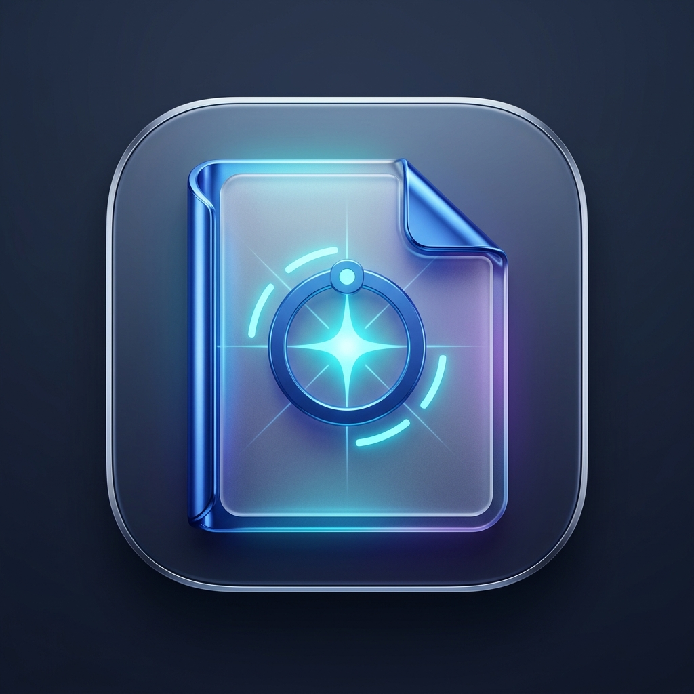

<div align="center">
  
  <h1>DocQuery AI</h1>
  <p><strong>Intelligent Document Assistant & Semantic RAG Engine</strong></p>
  <p>Enterprise-grade PDF Analysis application powered by Google Gemini AI, FastAPI, and React 19 (Vite). Designed with <strong>Google Stitch Design Tokens</strong>.</p>

  <p>
    <a href="https://docquery-frontend-dxdc.onrender.com/" target="_blank">
      
    </a>
  </p>
  <p>👉 <strong>Live Web App:</strong> <a href="https://docquery-frontend-dxdc.onrender.com/">https://docquery-frontend-dxdc.onrender.com</a></p>
</div>

---

## 📖 Complete User Guide: How to Use DocQuery AI

Welcome to **DocQuery AI**! Whether you are analyzing legal agreements, research papers, financial reports, or technical specifications, follow this step-by-step walkthrough to get the most out of the system.

> [!NOTE]
> **Free-Tier Deployment Notice:** Since DocQuery AI is hosted on Render's free tier, the backend web service spins down after periods of inactivity. If the app feels quiet or takes a moment on your first upload, please allow **30–50 seconds** for the backend to spin up. Once awake, all processing and streaming are blazing fast!

---

### Step 1: Accessing the App & Uploading Your PDF
1. Navigate to the live web application: **[https://docquery-frontend-dxdc.onrender.com](https://docquery-frontend-dxdc.onrender.com/)**.
2. In the main canvas or left sidebar, click **"Select PDF Document"** (or use the upload dropzone).
3. Select any standard `.pdf` document from your computer (e.g. contracts, research papers, corporate manuals).
4. Click the blue **"Read Document"** button.
5. In just a few seconds, DocQuery AI will:
   - Extract raw text and metadata page by page.
   - Segment the text into hierarchical 1000-character chunks with semantic overlap.
   - Generate dense vector embeddings via **Google Gemini Embeddings**.
   - Build an in-memory **FAISS vector index**.
6. Once ready, you'll see a green **"Ready"** status indicator with telemetry metrics showing the number of sections indexed and preparation time in seconds.

---

### Step 2: Conversational Document Querying (`📁 Documents` Tab)
1. Type any natural language question into the floating input bar at the bottom (e.g., *"What is the main hypothesis of this paper?"* or *"Summarize the payment terms in section 4"*).
2. Press **Enter** or click the **Arrow Up** button.
3. **Live Streaming Answers:** The AI retrieves the top 4 most relevant document chunks and streams answers token-by-token directly to your screen.
4. **Structured Markdown Output:** Responses are formatted automatically with **bold terms**, bullet lists, blockquotes, and Markdown tables for complex data.
5. **Instant In-Memory Cache:** Repetitive or identical questions return instantaneously (0ms wait time) without re-calling the LLM.

---

### Step 3: Using the Prompt Playbook & Audit History (`🕒 Recent Queries` Tab)
Click **"Recent Queries"** in the left sidebar to access your investigation audit log and pre-engineered workflows:

* **🚀 Prompt Playbook (1-Click Curated Workflows):**
  Click any pre-engineered card to run deep inquiries on your active document instantly:
  - **🎯 Executive Brief:** Generates a structured overview with background, key outcomes, and strategic recommendations.
  - **⚠️ Risks & Red Flags:** Audits the text for critical liabilities, compliance gaps, and vulnerabilities.
  - **📋 Action Items & Deliverables:** Compiles explicit tasks, assignees, obligations, and deadlines into a checklist.
  - **📈 Quantitative & Metrics Table:** Extracts financial figures, milestones, percentages, and metrics into a neat Markdown table.
  - **❓ Critical Q&A Guide:** Uncovers the top 5 questions and answers any executive or auditor would ask.
  - **⚖️ Strengths & Trade-offs:** Evaluates advantages, limitations, and assumptions discussed in the text.

* **📜 Searchable Query History:**
  - Every question you ask is automatically saved to your browser's local storage along with timestamps and the document name.
  - Use the search bar to filter through previous questions.
  - Click **"Re-run"** on any past card to quickly ask that question again in the live chat.

* **📥 Exporting Your Audit Log:**
  - Click **"Export History (.md)"** in the top right to download your entire Q&A research trail as a clean Markdown report.
  - Click the **Trash** icon if you want to wipe local history from your browser.

---

### Step 4: Autonomous Deep Extraction (`✨ Synthesis` Tab)
Click **"Synthesis"** in the left sidebar to unlock autonomous intelligence that analyzes the document holistically rather than answering single questions:

1. **Choose Your Synthesis Mode:**
   - **📋 Executive Brief:** Synthesizes an executive thesis, 4–6 core findings with bold lead-ins, boundary constraints, and next steps.
   - **❓ Auto-Generated FAQ:** Gemini autonomously discovers the 6–8 most critical questions a reader should know, complete with context-grounded answers.
   - **📊 Key Metrics & Data:** Automatically parses numerical statistics, monetary values, percentages, critical milestones, and key stakeholders into structured Markdown tables.
2. **Instant Caching:** Switching between synthesis tabs is instantaneous; reports are cached in memory so you don't have to wait or spend API quota twice.
3. **Actions:**
   - **🔄 Regenerate:** Re-runs fresh synthesis on demand.
   - **📋 Copy:** Copies the full report to your clipboard with one click.
   - **📥 Export (.md):** Downloads the synthesized brief as a standalone Markdown file.

---

### Step 5: Managing Documents (Reset & Switch)
* **Clear Current Chat:** Click **"Clear Messages"** in the sidebar to reset the chat conversation while preserving the loaded document index.
* **Upload a New Document:** Click **"Upload New PDF"** in the sidebar to wipe the current vector store and load a fresh document.

---

## 🏗️ Architecture

```
├── backend/
│   ├── main.py              # FastAPI server (upload, chat, streaming, synthesis, cache)
│   └── utils/
│       ├── chat_engine.py   # Gemini LLM streaming & conversation memory
│       ├── pdf_processor.py # Isolated PDF parsing & text chunking pipeline
│       └── vector_store.py  # FAISS vector store indexing & semantic retrieval
├── frontend/
│   ├── src/App.jsx          # React 19 app (Documents, Recent Queries, Synthesis Studio)
│   ├── index.html           # Google Fonts, Material Symbols, Tailwind CDN
│   └── package.json
├── requirements.txt         # Production Python dependencies
├── render.yaml              # Multi-service Render deployment blueprint
└── .env                     # Local API keys (GOOGLE_API_KEY)
```

---

## 🚀 Local Development

### Prerequisites
- Python 3.10+
- Node.js 18+
- [Google Gemini API Key](https://aistudio.google.com/)

### 1. Start the Backend API
```powershell
# Create & activate virtual environment (Windows PowerShell)
python -m venv venv
.\venv\Scripts\Activate.ps1

# Install dependencies
pip install -r requirements.txt

# Configure your API key
Copy-Item .env.example .env
# Open .env and add your GOOGLE_API_KEY=AIzaSy...

# Start FastAPI server
python -m uvicorn backend.main:app --reload --port 8000
```
Interactive API Swagger documentation will be available at: [http://localhost:8000/docs](http://localhost:8000/docs)

### 2. Start the React Frontend
```powershell
cd frontend
npm install
npm run dev
```
Open [http://localhost:5173](http://localhost:5173) in your browser.

---

## 📄 Technical Report

For in-depth architectural analysis, sequence diagrams, benchmark metrics, and system lifecycle documentation, see the [Technical Architecture Report](TECHNICAL_REPORT.md).
