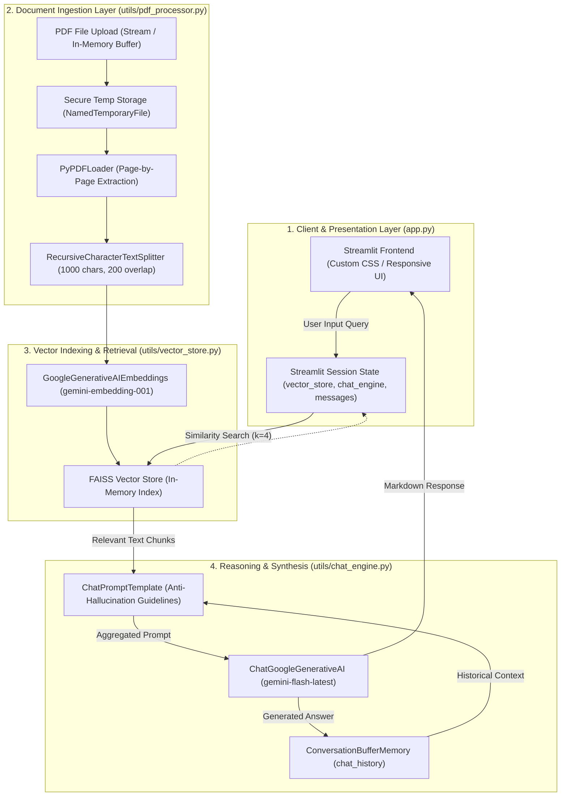
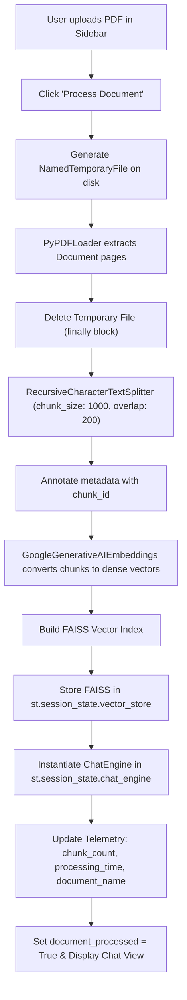
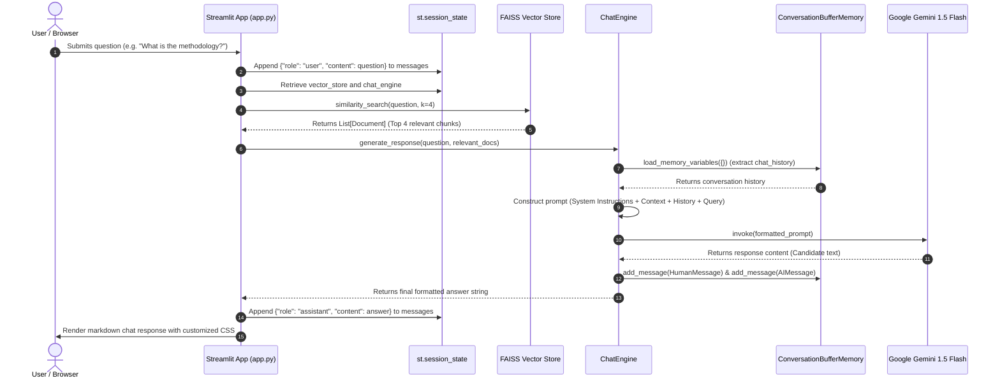
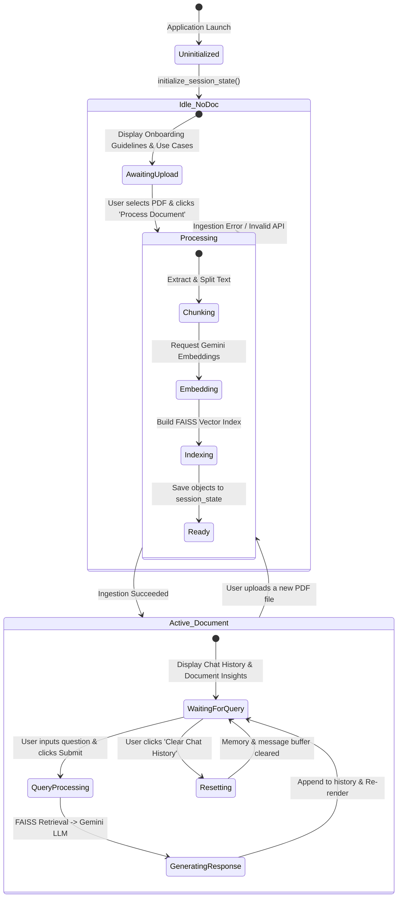

# Technical Architecture & System Report: DocQuery AI

**Project Name:** DocQuery - Intelligent PDF Document Query System  
**Repository Working Directory:** `DocQuery - PDF Chatbot_RAG`  
**Application Category:** Document Intelligence / Retrieval-Augmented Generation (RAG) System  
**Report Date:** 2026-10-29  

---

## 1. Executive Summary

**DocQuery AI** is an enterprise-grade Retrieval-Augmented Generation (RAG) conversational application designed to parse, index, and query unstructured PDF documents in natural language. Static PDF documents (such as technical specifications, research whitepapers, financial statements, and legal agreements) traditionally require tedious manual searching. DocQuery AI transforms these documents into an interactive semantic knowledge base.

By combining dense vector embeddings with **Google Gemini 1.5 Flash** and **FAISS (Facebook AI Similarity Search)**, DocQuery AI executes similarity searches over text segments and synthesizes context-grounded answers while maintaining conversational context over multi-turn interactions.

---

## 2. Technology Stack & Technical Specifications

| Layer / Role | Technology / Library | Version / Model Specification | Purpose |
| :--- | :--- | :--- | :--- |
| **User Interface & App Lifecycle** | Streamlit | `>= 1.30.0` | Reactive web interface, session state management, custom CSS rendering |
| **RAG Orchestration** | LangChain / LangChain Core / Classic | `langchain`, `langchain-core`, `langchain-classic`, `langchain-community` | Pipeline composition, prompt templating, conversational memory |
| **PDF Extraction & Parsing** | PyPDF | `pypdf` via `PyPDFLoader` | Binary PDF parsing, page extraction, and text normalization |
| **Text Chunking** | LangChain Text Splitters | `RecursiveCharacterTextSplitter` | Hierarchical chunk splitting with overlap |
| **Embedding Generation** | Google Generative AI | `models/gemini-embedding-001` | High-dimensional dense vector embeddings |
| **Vector Indexing & Retrieval** | FAISS (CPU) | `faiss-cpu` | L2/Cosine similarity vector index for top-$k$ nearest neighbors |
| **Large Language Model (LLM)** | Google Gemini | `gemini-flash-latest` (Gemini 1.5 Flash) | Reasoning, answer synthesis, markdown formatting |
| **Configuration & Security** | Python-dotenv | `python-dotenv` | API key isolation via local `.env` |
| **Markdown Rendering** | Python Markdown | `markdown` | Sanitized and structured HTML output formatting |

---

## 3. High-Level Architecture Diagram

The system follows a modular 4-tier architecture comprising Presentation, Ingestion/Processing, Vector Search, and Generative Synthesis:

---

## 4. In-Depth Component Analysis & Inner Workings

### 4.1 Document Ingestion & Chunking (`utils/pdf_processor.py`)
- **Class:** `PDFProcessor(chunk_size=1000, chunk_overlap=200)`
- **Mechanism:**
  1. Streamlit provides an `UploadedFile` object representing the raw byte stream of the PDF.
  2. The processor writes this stream to an isolated temporary file on disk using `tempfile.NamedTemporaryFile(delete=False, suffix=".pdf")`.
  3. `PyPDFLoader` reads and extracts page content along with source metadata (e.g., page numbers).
  4. The temporary file is immediately unlinked and removed within a `finally` block to prevent disk leakage.
  5. The extracted pages are split using `RecursiveCharacterTextSplitter`. The splitter operates hierarchically with separators `["\n\n", "\n", " ", ""]` to preserve semantic paragraphs, sentences, and words intact.
  6. Each chunk receives an incremental `chunk_id` in its `metadata` dictionary for traceability.

### 4.2 Vector Store & Semantic Embeddings (`utils/vector_store.py`)
- **Class:** `VectorStoreManager(api_key, embedding_model="models/gemini-embedding-001")`
- **Mechanism:**
  1. Utilizes Google Gemini's dense embedding model (`models/gemini-embedding-001`) to map textual segments into high-dimensional embedding vectors.
  2. Instantiates an in-memory `FAISS` index via `FAISS.from_documents(documents, embeddings)`.
  3. Provides `similarity_search(query, k=4)` to retrieve the top 4 most semantically similar chunks based on vector distance.
  4. Provides serialization capabilities (`save_local` and `load_local`) enabling index persistence if required.

### 4.3 Generative Engine & Grounded Prompting (`utils/chat_engine.py`)
- **Class:** `ChatEngine(api_key, model="gemini-flash-latest")`
- **Mechanism:**
  1. Configures `ChatGoogleGenerativeAI` with hyperparameters:
     - `temperature = 0.3` (low temperature to prioritize factual precision and minimize creative deviation)
     - `top_p = 0.95`
     - `max_output_tokens = 2048`
  2. Integrates `ConversationBufferMemory` to maintain full conversational context (`chat_history`) between successive questions.
  3. Enforces an explicit System Prompt template:
     - **Strict Context Boundary:** Answers must rely strictly on provided context chunks.
     - **Negative Constraint:** If the document does not contain the answer, the model must declare: *"I cannot find this information in the document."*
     - **Formatting Directives:** Bold terms, markdown tables for tabular data, and bullet points for lists.
  4. Context chunks are joined using distinct separators (`\n\n---\n\n`) and injected directly into `{context}` alongside `{chat_history}` and `{input}`.
  5. The output is parsed to guarantee clean string retrieval (supporting both plain string responses and multi-part dictionary structures).
  6. The interaction is recorded into the chat memory buffer via `HumanMessage` and `AIMessage`.

### 4.4 Presentation Layer & Session Lifecycle (`app.py`)
- **UI Framework:** Streamlit wide layout with custom CSS injecting an indigo-to-blue modern theme, elevated card aesthetics, responsive mobile media queries, and role-colored speech bubbles.
- **Session State Variables:**
  - `vector_store`: Holds the active FAISS index.
  - `chat_engine`: Holds the active `ChatEngine` instance with memory.
  - `messages`: List of message dictionaries (`role`, `content`) displayed in chronological order.
  - `document_processed`: Boolean flag gating the interface between the upload onboarding view and the interactive chat UI.
  - `document_name`, `processing_time`, `chunk_count`: Telemetry metrics presented in the sidebar dashboard.

---

## 5. Flow Diagrams

### 5.1 Document Processing & Indexing Flow

---

### 5.2 Query & Retrieval-Augmented Generation Flow (Sequence Diagram)

---

### 5.3 Application State Lifecycle

---

## 6. How the Application Works (Step-by-Step Execution Guide)

1. **Environment Initialization:**
   The application initializes by loading `.env` via `python-dotenv` to fetch `GOOGLE_API_KEY`. It registers custom CSS to style the header, KPI stat cards, and chat bubbles.
2. **Session State Initialization:**
   `initialize_session_state()` ensures that persistent session variables (`vector_store`, `chat_engine`, `messages`, `document_processed`, `chunk_count`, `processing_time`) exist without being reset on every Streamlit script re-run.
3. **Document Ingestion:**
   When a user submits a PDF:
   - `PDFProcessor` saves the uploaded stream into a temporary disk file.
   - `PyPDFLoader` reads text from the PDF pages.
   - The file is deleted from disk immediately.
   - `RecursiveCharacterTextSplitter` segments the document into 1000-character chunks with a 200-character overlap to retain context across boundaries.
4. **Vector Store Creation:**
   `VectorStoreManager` sends the text chunks to Google's embedding model (`gemini-embedding-001`). The returned vector embeddings are indexed locally using FAISS. The resulting index is assigned to `st.session_state.vector_store`.
5. **Chat Engine Setup:**
   A `ChatEngine` instance is initialized with `gemini-flash-latest` and an empty `ConversationBufferMemory`.
6. **Query & Retrieval Execution:**
   When the user submits a question:
   - FAISS calculates the vector distance between the query embedding and all indexed chunk vectors, returning the top 4 chunks ($k=4$).
   - The chunks are combined into a structured context string separated by dividers.
   - The system prompt, conversation history, and query are injected into the template.
   - Gemini 1.5 Flash generates an answer grounded in the provided document context.
7. **Memory & UI Update:**
   The question and answer are recorded in the conversation memory. Streamlit renders the conversation using Python's `markdown` library and custom CSS styling.

---

## 7. Security, Reliability & Operational Best Practices

- **API Credential Security:** The Google Gemini API key is isolated inside `.env` and loaded at runtime via `os.getenv()`. The `.gitignore` prevents inadvertent leakage of `.env`, `.faiss`, `.pkl`, and temporary files.
- **Temporary File Disposal:** `utils/pdf_processor.py` implements a `try...finally` block that unlinks temporary PDF files immediately after extraction, preventing local storage accumulation or cross-session leakage.
- **Strict Anti-Hallucination Guardrails:** Prompt engineering specifies that the model must explicitly state when an answer is not present in the document, rather than synthesizing unsupported facts.
- **Response Format Normalization:** `utils/chat_engine.py` defensively checks whether `response.content` is returned as a plain string or a list of parts, extracting plain text in either scenario.

---

## 8. Limitations & Recommendations for Future Enhancement

| Area | Current Implementation | Proposed Future Enhancement |
| :--- | :--- | :--- |
| **Vector Persistence** | In-memory within Streamlit session state; lost when session ends or resets. | Persist FAISS indexes or integrate managed cloud vector DBs (e.g., ChromaDB, Pinecone, pgvector). |
| **Complex Document Parsing** | Basic text parsing via `PyPDFLoader` (ignores tables and scanned images). | Integrate unstructured loaders or OCR pipelines (e.g., `pdfplumber`, `unstructured`, `pytesseract`) to parse scanned PDFs, diagrams, and tables. |
| **Retrieval Strategy** | Fixed dense retrieval with top-$k=4$. | Implement **Hybrid Search** (BM25 lexical search + FAISS dense search) combined with **Reranking** (e.g., Cohere/Cross-Encoder Reranker). |
| **Long-Conversation Memory** | `ConversationBufferMemory` keeps all turns, which can scale up token usage. | Switch to `ConversationSummaryMemory` or sliding-window token buffer memory to optimize token consumption. |
| **Citation Granularity** | General instruction to cite sections where possible. | Explicitly attach chunk metadata (page number, chunk ID) to the final output as clickable footnotes or source highlights. |
| **Streaming Responses** | Whole response generated before rendering (`st.spinner`). | Implement token streaming via `st.write_stream` and `llm.stream()` for lower perceived latency. |

---

## 9. Conclusion

DocQuery AI presents an efficient, modular, and maintainable implementation of the Retrieval-Augmented Generation paradigm using LangChain, Google Gemini, FAISS, and Streamlit. Its separated utility modules (`pdf_processor.py`, `vector_store.py`, `chat_engine.py`) establish a clear boundary between presentation, indexing, retrieval, and inference, serving as a solid blueprint for scalable enterprise document intelligence.

